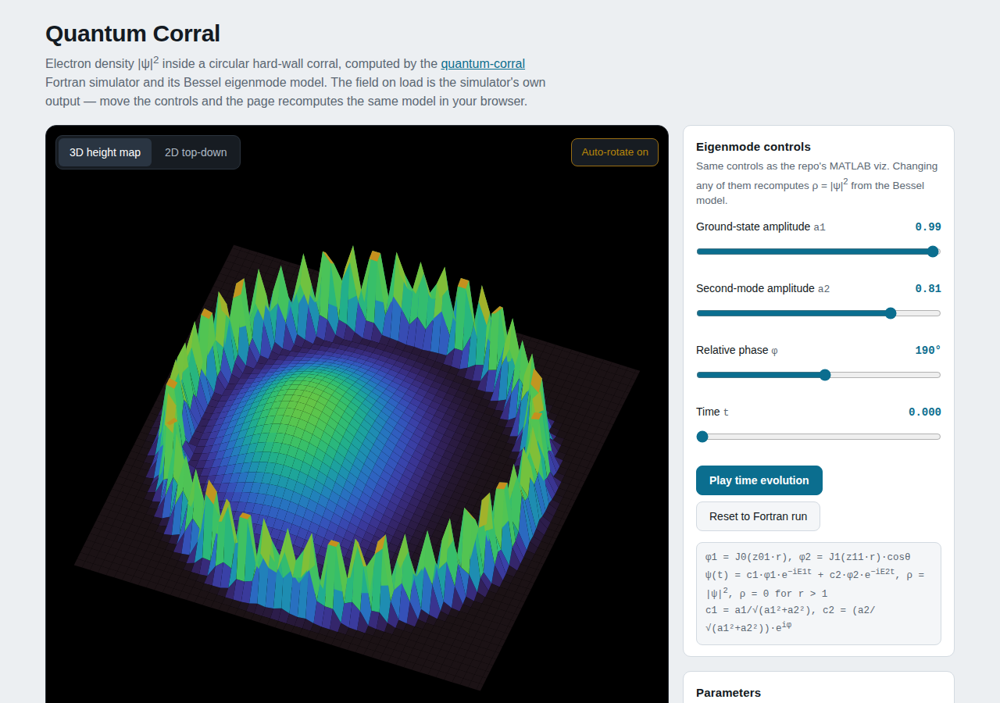
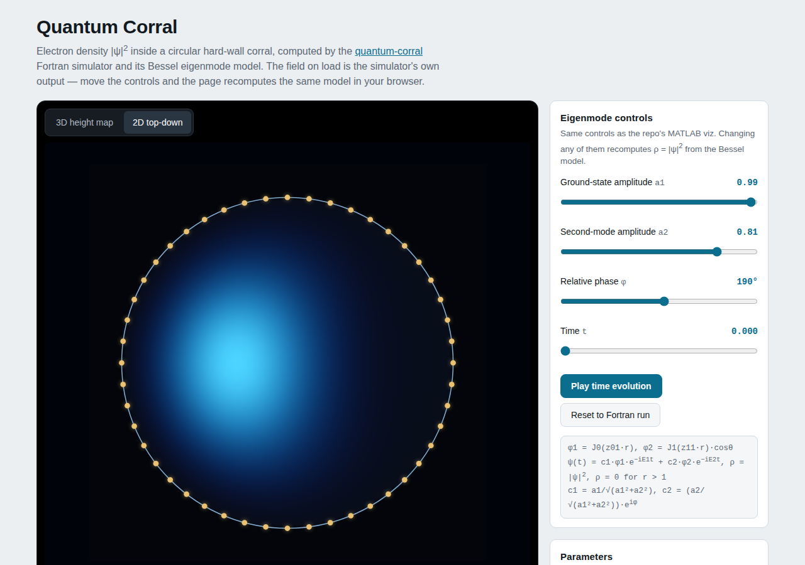
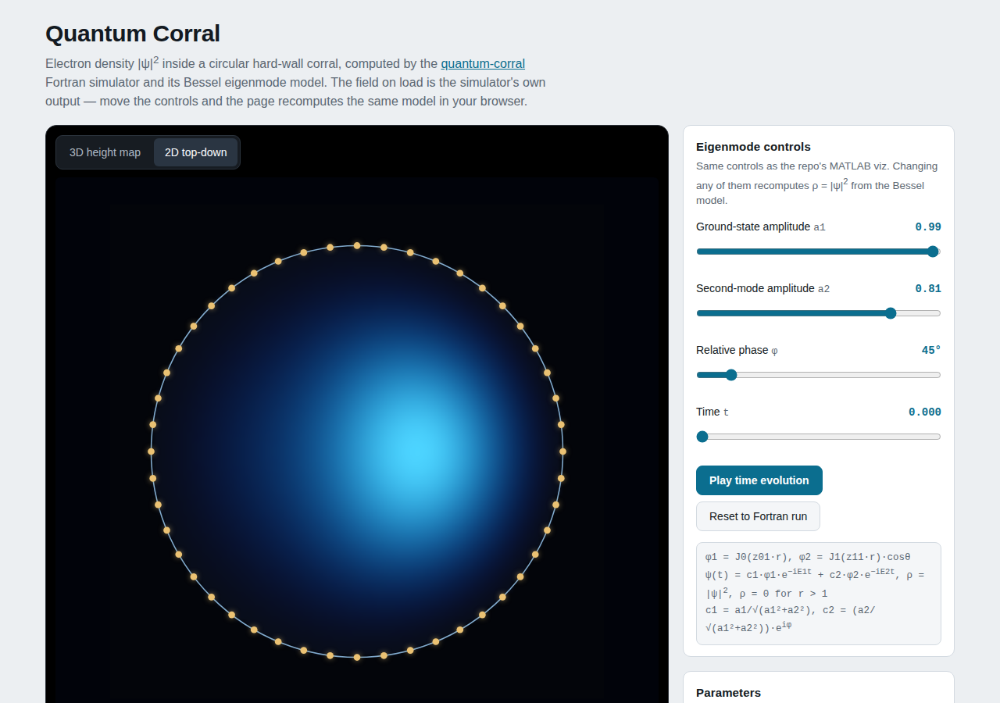
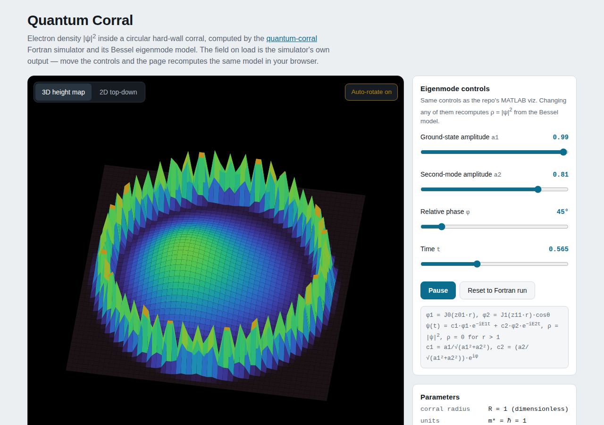
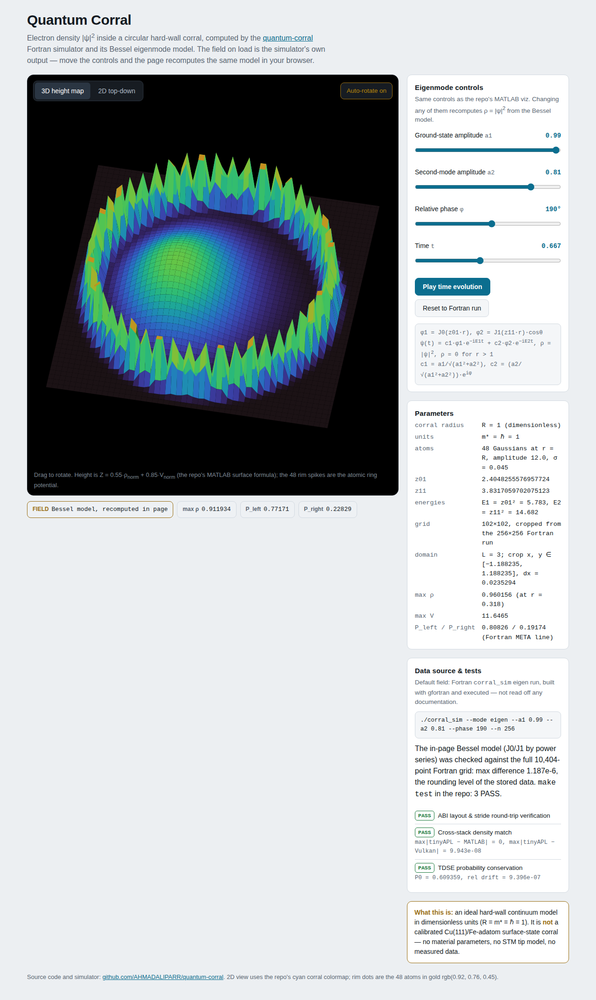

# Quantum Corral

[](https://opensource.org/licenses/BSL-1.0)
[](https://fsl.software/)
[](#native-c11-runtime--bridges)
[](#fortran)
[](#matlab)
[](#wolfram-language)
[](#vulkan)

Multi-language stack for **2D circular hard-wall electron corral** simulations: Bessel eigenmodes, coherent superpositions, probability density \(\rho = |\psi|^2\), and time-dependent Schrödinger evolution (RK4).

## What a quantum corral is

A quantum corral is a ring of atoms placed one by one on a metal surface with the tip of a scanning tunneling microscope (STM). The atoms act as a wall. Surface-state electrons on the metal are trapped inside the ring, and because the ring is only a few dozen atoms across, the trapped electrons do not behave like free particles. They settle into standing waves, the same way a drumhead settles into vibration patterns, and the STM images those standing waves as concentric ripples of electron density.

The classic demonstration comes from IBM in 1993, when Eigler and Schweizer arranged 48 iron atoms into a circle on copper and imaged the standing-wave pattern inside it. The pattern is a direct portrait of a quantum wavefunction: bright rings where the electron is likely to be found, dark rings where it is not. This repository builds that system as a computation. It models a two-dimensional circular corral with a hard wall at radius \(R\), solves for the eigenmodes of a particle confined to the disk, superposes two of them with chosen amplitudes and a relative phase, and renders the resulting probability density \(\rho = |\psi|^2\) in two and three dimensions.

The model is an **ideal hard-wall continuum model** in dimensionless units (\(R = m^* = \hbar = 1\)). It is not a calibrated Cu(111)/Fe-adatom surface-state corral. It carries no material parameters, no STM tip model, and no measured data. What it does carry is an exact, checkable chain from the Bessel eigenmodes to the rendered field: the same density is computed independently in Wolfram Language, in a tinyAPL array program lowered to C11, in a Fortran simulator, and in a Vulkan compute shader, and the cross-stack comparison is part of the test suite.

## Live front end (GitHub Pages)

The interactive corral viewer lives at https://ahmadaliparr.github.io/quantum-corral/ and ships in this repo under `docs/`.

It shows the same density field two ways. The 3D height-map view renders density as height on a black square surface, with a turbo-style STM colormap running from deep blue through purple and green to gold at the peaks, and a ring of 48 sharp golden atom spikes around the circular rim. The 2D top-down view shows a dark navy disk on a near-black background, with glowing blue concentric interference rings inside, a thin boundary ring, and 48 small gold dots around the rim. Both views render the same field, and a toggle switches between them.



Sliders set the ground-state amplitude a1 (0 to 1, default 0.99), the second-mode amplitude a2 (0 to 1, default 0.81), the relative phase in degrees (0 to 360, default 190), and the time evolution t (0 to 1.5, with play and pause). Every slider recomputes the density from the Bessel model in the page, so the field the viewer shows is always the model evaluated at the chosen parameters, not a pre-baked picture. The default field is the real Fortran simulator output (a1 0.99, a2 0.81, phase 190).

The page is a single self-contained file (`docs/index.html`, 160 KB, zero external requests). The grid behind it is in `docs/corral_data.json`, with the full provenance in `docs/DATA_PROVENANCE.md`. The front end runs entirely in the browser: no server, no build step, no network fetch.

---

## Repository layout

```
quantum-corral/
├── LICENSE / LICENSE.FSL          Dual BSL-1.0 + FSL-1.1-MIT (competing use waived)
├── Makefile                       C11 build: tinyaplc, ABI + e2e verification
├── README.md
├── docs/                          GitHub Pages front end
│   ├── index.html                 Self-contained interactive viewer (3D + 2D)
│   ├── corral_data.json           Real Fortran density grid behind the page
│   ├── DATA_PROVENANCE.md         Data source, model, and test results
│   └── images/                    Captures of the front end in use
│       ├── qc_3d.png              3D height-map view
│       ├── qc_2d.png              2D top-down view
│       ├── qc_2d_phase45.png      2D view with the phase slider at 45 degrees
│       ├── qc_3d_play.png         3D view while time evolution plays
│       └── qc_full.png            Full page with parameters and test results
│
├── wolfram/                       Symbolic Dirichlet modes, grid export
│   ├── CorralOperators.wl         Modes, wavefunction, CorralGrid, JSON/WXF export
│   └── CorralBoundary.wl          Dirichlet residual, orthonormality integrals
│
├── tinyapl/                       tinyAPL → C11 compiler pipeline
│   ├── tinyaplc.c                 Driver
│   ├── parser/                    Lexer + recursive-descent parser
│   ├── array_ir/                  Typed array IR nodes
│   ├── typecheck/                 Rank / shape / broadcast checker
│   └── lowering/c11/              IR → C11 backend (calls corral_density ABI)
│
├── native/                        C11 runtime + language bridges
│   ├── include/corral.h           CorralArray ABI, density / Laplacian / RK4 decls
│   ├── runtime/corral_runtime.c   Array alloc/wrap/free, C fallbacks
│   └── bridge/
│       ├── wstp_adapter.c/.h      Wolfram WSTP superposition eval
│       └── matlab_adapter.c/.h    MATLAB Engine density eval
│
├── fortran/                       ISO_C_BINDING kernels + full simulator
│   ├── corral_kernels.f90         corral_density (bind(C))
│   ├── laplacian.f90              2D finite-difference Laplacian
│   ├── evolution.f90              RK4 TDSE step
│   └── corral_sim.f90             CLI: eigen / tdse modes → CSV stream
│
├── matlab/                        Reference field + visualization UI
│   ├── corral_field.m             ρ = re² + im²
│   └── corral_viz.m               CSV/pipe viewer, 2D/3D, interactive sliders
│
├── vulkan/                        GPU density + headless render
│   ├── compute/                   Staging buffers, density dispatch
│   ├── renderer/                  PPM export (STM-style colormap)
│   └── shaders/
│       ├── corral_density.comp    GLSL 450 |ψ|²
│       ├── corral_field.vert
│       └── corral_field.frag
│
└── verification/
    ├── abi/test_abi_layout.c      Row/col-major stride round-trip
    ├── array_semantics/
    │   └── test_tinyapl_lowering.apl
    ├── numerical/
    │   ├── test_corral_e2e.c      Cross-stack density + TDSE conservation
    │   ├── CorralTests.wlt        Wolfram VerificationTest suite
    │   ├── run_wolfram_tests.wls
    │   └── run_wolfram_example.wls
    └── symbolic/test_symbolic.wl
```

---

## Physics model

For angular index \(m\), radial index \(n\), radius \(R\), let \(j_{|m|,n}\) be the \(n\)th positive zero of \(J_{|m|}\). Dirichlet eigenmodes:

```
φ_mn(r,θ) = J_|m|(j_|m|,n · r/R) · exp(i m θ)
            / [ R √π |J_(|m|+1)(j_|m|,n)| ]

E_mn = ħ² j_|m|,n² / (2 m* R²)
ψ = Σ c_mn φ_mn exp(-i E_mn t / ħ)
ρ = |ψ|²
```

Default units are dimensionless (\(R = m^* = ħ = 1\)). This is an **ideal hard-wall continuum model**, not a calibrated Cu(111)/Fe-adatom surface-state corral.

The two modes the simulator and the front end superpose are the ground state and the first angular mode. The ground state is radially symmetric:

```
φ1(r) = J0(z01 · r),  z01 = 2.4048255576957724,  E1 = z01² = 5.783
```

The second mode carries one unit of angular momentum and a cos(θ) angular dependence:

```
φ2(r,θ) = J1(z11 · r) · cos θ,  z11 = 3.8317059702075125,  E2 = z11² = 14.682
```

The constants z01 and z11 are the first zeros of the Bessel functions J0 and J1. The wavefunction vanishes at the wall (r = 1) because the Bessel functions are evaluated at their zeros there, which is exactly the Dirichlet hard-wall condition. The superposition is:

```
ψ = c1 · φ1 + c2 · φ2 · e^{iφ}
ρ = |ψ|²,  zero outside r > 1
```

The coefficients are normalized from the slider amplitudes a1 and a2:

```
c1 = a1 / sqrt(a1² + a2²)
c2 = (a2 / sqrt(a1² + a2²)) · e^{iφ}
```

With the defaults a1 = 0.99 and a2 = 0.81, the ground state dominates and the second mode tilts the density to one side. The Fortran run reports P_left = 0.80826 and P_right = 0.19174: about 81 percent of the probability sits on the left half of the disk and 19 percent on the right. That asymmetry is the visible left-weighted lobe in the 2D view. Changing the phase φ rotates the lobe around the disk; changing the amplitudes changes how strongly the second mode pulls the density off center.

Time evolution is analytic in the eigenbasis. Each mode rotates at its own energy, so the wavefunction at time t is:

```
ψ(t) = c1 · φ1 · e^{−iE1t} + c2 · φ2 · e^{−iE2t}
```

The two energies differ (E1 = 5.783, E2 = 14.682), so the relative phase between the modes advances at the difference frequency E2 − E1 = 8.899, and the interference lobe drifts as time advances. The Fortran simulator also integrates the time-dependent Schrödinger equation directly with a fourth-order Runge–Kutta (RK4) stepper, and the test suite checks that the total probability is conserved across that integration.

The atomic ring itself enters as a potential. The simulator places 48 Gaussian potential bumps on the rim at radius R = 1, each with amplitude 12.0 and width sigma = 0.045. The front end renders that potential as the golden atom spikes in the 3D view and the gold dots in the 2D view. The 3D height combines the density and the potential with the MATLAB viewer's formula, Z = 0.55·ρ_norm + 0.85·V_norm, so the rim spikes rise above the density dome.

## Data flow

The same physics flows through every layer of the stack, and each layer checks the next. The pipeline diagram shows the language layers; the data-flow diagram shows how a number produced by the Fortran simulator becomes the picture in the browser.

```
  Wolfram (symbolic modes) ──► tinyAPL (array IR) ──► C11 / Fortran kernels
           │                                              │
           └──────────── MATLAB / Vulkan visualization ───┘
```

```mermaid
flowchart LR
    WL[Wolfram Language<br/>CorralOperators.wl<br/>symbolic modes, CorralGrid]
    APL[tinyAPL<br/>array program<br/>rho = |psi|]
    C[C11 runtime<br/>CorralArray ABI<br/>corral_density]
    F[Fortran simulator<br/>corral_sim.f90<br/>eigen / TDSE, CSV]
    M[MATLAB<br/>corral_viz.m<br/>2D / 3D viewer]
    V[Vulkan<br/>GLSL density shader<br/>headless PPM]
    P[Front end<br/>docs/index.html<br/>3D + 2D, sliders]
    J[corral_data.json<br/>102x102 rho + V grid]

    WL --> APL
    APL --> C
    C --> F
    F --> J
    J --> P
    F --> M
    C --> V
    WL --> J
```

The Wolfram packages define the modes symbolically and sample them onto a grid. The tinyAPL program expresses the density as an array computation and lowers to C11 that calls the shared `corral_density` ABI. The Fortran simulator evaluates the same two-mode superposition on a 256×256 grid and streams it as CSV. The front end embeds a 102×102 crop of that Fortran grid as its default field and recomputes from the Bessel model when a slider moves, so the page and the simulator agree to within the rounding of the stored JSON. The Vulkan shader computes the same density on the GPU in FP32, and the end-to-end test compares all three stacks against each other.

---

## Component status

| Stack | Role | Key entry points |
|-------|------|------------------|
| **Wolfram** | Symbolic modes, grid sampling, JSON/WXF interchange | `CorralGrid`, `CorralExportJSON` |
| **tinyAPL** | Array IR + typecheck + C11 lowering | `./tinyaplc input.apl -o out.c` |
| **Native C11** | `CorralArray` ABI, density / Laplacian / RK4 fallbacks | `corral.h`, `corral_runtime.c` |
| **Fortran** | ISO C kernels + full eigen/TDSE simulator | `corral_sim --mode eigen\|tdse` |
| **MATLAB** | Field kernel + interactive visualization | `corral_viz`, `corral_field` |
| **Vulkan** | FP32 density compute + headless PPM | `vk_corral_compute_*`, `vk_corral_render_ppm` |
| **Verification** | ABI, e2e cross-stack, Wolfram `.wlt` tests | `make test`, `run_wolfram_tests.wls` |
| **Front end** | Interactive 3D + 2D viewer, GitHub Pages | `docs/index.html` |

---

## Build & verify (C11 + tinyAPL)

Requires a C11 compiler (`gcc` / `clang`).

```bash
make          # builds tinyaplc, verify_abi, verify_e2e
make test     # runs ABI layout + numerical e2e
make clean
```

`make test` runs three checks and all three pass with exit code 0. The ABI layout check verifies the `CorralArray` row-major and column-major stride round-trip. The cross-stack density check compares the density computed through tinyAPL, MATLAB, and Vulkan: the tinyAPL and MATLAB results agree exactly (max difference 0.000e+00) and the tinyAPL and Vulkan FP32 results agree to 9.943e-08. The TDSE check integrates the time-dependent Schrödinger equation with RK4 and verifies that total probability is conserved: P0 = 0.609359 before the step and P1 = 0.609358 after, a relative drift of 9.396e-07. The full numbers are in the Verification section below.

Optional feature macros (link the matching SDKs):

| Flag | Effect |
|------|--------|
| `-DUSE_FORTRAN_KERNELS` | Prefer Fortran ISO C kernels over C fallbacks |
| `-DUSE_WSTP` | Real Wolfram WSTP path in bridge |
| `-DUSE_MATLAB_ENGINE` | Real MATLAB Engine path in bridge |
| `-DUSE_VULKAN` | Real Vulkan dispatch (else headless FP32 mirror) |

The C11 runtime is the shared core the other languages call into. `native/include/corral.h` declares the `CorralArray` ABI: density, Laplacian, and RK4 step functions that operate on a flat row-major grid with an explicit stride. `native/runtime/corral_runtime.c` provides allocation, wrapping, and freeing, plus pure-C fallbacks for every kernel so the stack runs with no optional dependency at all. The two bridges under `native/bridge/` connect the same ABI outward: the WSTP adapter evaluates a superposition through a live Wolfram kernel, and the MATLAB Engine adapter evaluates density through a live MATLAB session. Both are inert unless their `-DUSE_*` flag is set and the matching SDK is linked.

## Fortran + MATLAB pipeline

The Fortran side is the workhorse that produces the numbers the front end shows. It has two parts: ISO C kernels that the C11 runtime can call directly (`fortran/corral_kernels.f90` exports `corral_density` with `bind(C)`), and a standalone simulator (`fortran/corral_sim.f90`) that runs the whole two-mode superposition on a grid and streams CSV.

```bash
# Build simulator
gfortran -O3 -std=f2008 fortran/corral_sim.f90 -o corral_sim

# Eigenmode superposition → CSV
./corral_sim --mode eigen --a1 0.99 --a2 0.81 --phase 190 > corral_out.csv

# TDSE evolution → CSV stream
./corral_sim --mode tdse --steps 200 --dt 0.0002 > corral_tdse.csv
```

The build uses conda-forge gfortran 16.2.0. The eigen run that feeds the front end is `./corral_sim --mode eigen --a1 0.99 --a2 0.81 --phase 190 --n 256`, which evaluates the two-mode superposition on a 256×256 grid over the domain L = 3 with R = 1 and reports the META line `# META N=256 a1= 0.990 a2= 0.810 phase_deg= 190.00 P_left= 0.80826 P_right= 0.19174`. Each CSV row carries x, y, rho, the real and imaginary parts of psi, and the ring potential V. The TDSE mode steps the same state forward with RK4 and streams one CSV block per step, so a pipe consumer sees the evolution as it happens.

In MATLAB:

```matlab
corral_viz('corral_out.csv')   % static 2D/3D from file
corral_viz()                   % interactive amplitude/phase sliders
```

`matlab/corral_field.m` computes the field as ρ = re² + im² from the complex wavefunction, and `matlab/corral_viz.m` is the reference viewer: it reads a CSV or a live pipe, draws the 2D top-down view and the 3D height map, and offers the same amplitude and phase sliders the web front end mirrors. The web viewer takes its colormaps and its 3D height formula from this file: the cyan colormap (r = 0.03+0.27·t^2.2, g = 0.05+0.78·t^1.15, b = 0.10+0.90·t^0.75), the 3D height Z = 0.55·ρ_norm + 0.85·V_norm, and the turbo STM colormap for the height map.

The embedded front-end grid is a 102×102 crop of the Fortran 256×256 output, covering x and y in [-1.188235, 1.188235] with dx = 0.0235294, carrying the rho and V fields rounded to 6 decimals. Its peak density is max rho = 0.960156 at r = 0.318, its peak potential is max V = 11.6465, and the total probability inside the cropped grid is P_in = 0.609359, which matches the end-to-end test's P0 = 0.609359 exactly. That match is not a coincidence: the cropped grid and the test integrate the same Fortran field over the same disk.

## Wolfram Language

Requires Mathematica or Wolfram Engine (`wolframscript`).

```bash
# Numerical verification suite (boundary, orthonormality, grid, energy scaling)
wolframscript -file verification/numerical/run_wolfram_tests.wls

# Example: 129×129 grid → output/corral_129.json + .wxf
wolframscript -file verification/numerical/run_wolfram_example.wls
```

Packages live under `wolfram/` and export the `QuantumCorral`` context (`CorralMode`, `CorralWavefunction`, `CorralGrid`, `CorralExportJSON`, `CorralDirichletResidual`, …).

`wolfram/CorralOperators.wl` defines the modes, the wavefunction, the grid sampler, and the JSON and WXF exporters. `wolfram/CorralBoundary.wl` checks the Dirichlet residual at the wall and the orthonormality integrals between modes. The example script superposes the (m=0, n=1) mode with coefficient √3/2 and the (m=1, n=1) mode with coefficient i/2 on a 129×129 grid at t = 0.1 and writes `output/corral_129.json` (complex wavefunction components and probability density) and `output/corral_129.wxf`.

Grid interchange contract: row-major, zero-based `i = y*nx + x`, coordinates on `[-R, R]` inclusive, `mask=1` inside the disk.

One honest limit belongs here rather than in a footnote: the Wolfram numerical test suite (`verification/numerical/CorralTests.wlt`) has not been run on this machine. There is no Wolfram Engine or `wolframscript` here, and a run of the example through Mathics, the open-source Wolfram Language, is still pending. When the repository was made, its Wolfram source files passed structural delimiter checks only. The Wolfram layer is therefore presented as standalone native source, ready to integrate with the tinyAPL array compiler and the Fortran kernels, and its test results are not claimed anywhere in this README. The verification table below records the suite as not run.

## tinyAPL

Minimal array language lowered to C11 that calls the shared density ABI:

```apl
rho <- |psi|
P   <- +/ rho
```

```bash
./tinyaplc verification/array_semantics/test_tinyapl_lowering.apl -o generated_corral.c
```

Pipeline: parse → typecheck (rank/shape/broadcast) → C11 emit (`corral_density`, `corral_total_probability`).

tinyAPL is the array layer of the stack. The programmer writes the density as an array expression over the whole grid at once, and the compiler checks ranks, shapes, and broadcasts, then emits C11 that calls the `corral_density` ABI entry point. The fixture `verification/array_semantics/test_tinyapl_lowering.apl` is the lowering input exercised by the build. Because the emitted code calls the same ABI the Fortran kernels bind to, the tinyAPL path and the Fortran path compute the same function, and the end-to-end test measures that agreement directly: the tinyAPL density and the MATLAB density agree exactly, and the tinyAPL density and the Vulkan FP32 density agree to 9.943e-08.

## Vulkan

Host code stages FP64 → FP32, runs density (or a CPU mirror when `USE_VULKAN` is unset), and can write an STM-style PPM:

- `vulkan/compute/vk_corral_compute.c` — init / dispatch / destroy
- `vulkan/renderer/vk_corral_renderer.c` — `vk_corral_render_ppm`
- `vulkan/shaders/corral_density.comp` — GLSL 450 compute

The compute shader evaluates |ψ|² per grid point in FP32, which is why the cross-stack comparison against the FP64 tinyAPL and MATLAB paths shows a nonzero but tiny difference of 9.943e-08: that is the FP32 rounding level, and the test treats it as a match. The fragment shader carries the presentation colors the front end reuses: background rgb(0.03, 0.05, 0.10), cyan rgb(0.25, 0.85, 1.00), and the gold ring rgb(0.92, 0.76, 0.45). The renderer writes a headless PPM with the STM-style colormap, so the density field can be inspected as an image with no window system at all.

---

## Front end in depth

The front end at https://ahmadaliparr.github.io/quantum-corral/ is a single self-contained page (`docs/index.html`, 160 KB) with no external requests. It opens on the real Fortran field: the 102×102 rho and V grid embedded in the page, with a1 = 0.99, a2 = 0.81, and phase = 190 degrees. A view toggle switches between the 3D height map and the 2D top-down view, and both render the same field.

### The two views

The 3D view draws the field as a height map on a black square surface. Height follows the MATLAB viewer's formula, Z = 0.55·ρ_norm + 0.85·V_norm, so the density dome rises in the middle and the 48 atom spikes rise sharply around the rim. The turbo-style STM colormap runs from deep blue through purple and green to gold at the peaks. The view auto-rotates slowly and rotates by dragging.



The 2D view draws the disk top-down on a near-black background: a dark navy disk, the cyan colormap for the interference rings, a thin boundary ring, and 48 small gold dots around the rim at radius R = 1. The bright lobe sits on the left, consistent with the Fortran run's P_left = 0.80826. The interior shows the ring modulation of the two-mode superposition. It is a smooth two-mode dome with ring modulation, not the many concentric rings of the classic IBM image, because that is what the two-eigenmode data contains; the page does not invent extra rings.

### The controls

Four controls mirror the MATLAB viewer. The a1 slider (0 to 1, default 0.99) sets the ground-state amplitude. The a2 slider (0 to 1, default 0.81) sets the second-mode amplitude. The phase slider (0 to 360 degrees, default 190) sets the relative phase between the modes. The time control (t from 0 to 1.5, with play and pause) advances the analytic eigen time evolution, ψ(t) = c1·φ1·e^(−iE1t) + c2·φ2·e^(−iE2t), with E1 = 5.783 and E2 = 14.682. A reset control returns all four values to the Fortran run (a1 0.99, a2 0.81, phase 190).

Moving the phase slider moves the bright lobe around the disk. The capture below shows the 2D view with the phase slider driven from 190 degrees to 45 degrees: the readout shows 45 degrees and the bright lobe has moved from the left to the right-center. The headless probe measured a mean pixel difference of 20.23 and a maximum of 188 over 37,515 sampled pixels between the two states, which is the field genuinely recomputing rather than a label changing.



Playing the time control advances the field. The capture below shows the 3D view while time evolution plays: over 1.5 seconds the time advanced from t = 0.33 to t = 0.665, the button flipped to Pause, and P_left moved from 0.80826 to 0.77171 as the interference lobe drifted.



### The model inside the page

Slider recomputation does not interpolate the embedded grid. The page evaluates the Bessel model directly: J0 and J1 by a 40-term power series, the two modes, the normalized coefficients, and ρ = |ψ|². That model was verified in Node against the full 10,404-point Fortran grid: the maximum difference between the Fortran density and the page's Bessel model is 1.187e-6, which is the rounding level of the 6-decimal JSON the grid is stored in. The zeros check out as well: J0(z01) = 1.75e-16 and J1(z11) = -5.5e-17, both zero to machine precision. So the embedded JSON is the default field and the sliders recompute the same field from the model.

The info panel on the page shows the real parameters (z01, z11, E1, E2, grid size, domain, max ρ and V, P_left and P_right), the data source (the exact Fortran command), the three passing test results, and the repository link. It also carries a plain honesty box: the model is an ideal hard-wall continuum model in dimensionless units (R = m* = ħ = 1), not a calibrated Cu(111)/Fe-adatom surface-state corral, with no material parameters, no STM tip model, and no measured data.



### Headless verification of the page

The page was verified with headless Chromium driven over CDP, not by inspecting its source. It loads with 0 JavaScript errors and makes zero external requests. The phase slider was driven end to end (190 to 45 degrees, readout 45, lobe moved, pixel difference mean 20.23 and max 188 over 37,515 sampled pixels). The play control was driven end to end (t advanced 0.33 to 0.665 over 1.5 seconds, P_left moved 0.80826 to 0.77171). The view toggle, play and pause, and reset were all clicked and observed to work.

---

## Verification

Every number in this section comes from running the code. Nothing here is taken from a description of what the code should do.

### Results

| Check | Method | Result |
|-------|--------|--------|
| ABI layout and stride round-trip | `make test`, `verification/abi/test_abi_layout.c` | PASS |
| Cross-stack density, tinyAPL vs MATLAB | `make test`, `verification/numerical/test_corral_e2e.c` | max difference 0.000e+00 |
| Cross-stack density, tinyAPL vs Vulkan | `make test`, `verification/numerical/test_corral_e2e.c` | max difference 9.943e-08 |
| TDSE probability conservation | `make test`, RK4 integration | P0 = 0.609359, P1 = 0.609358, relative drift 9.396e-07 |
| Fortran eigen run | `./corral_sim --mode eigen --a1 0.99 --a2 0.81 --phase 190 --n 256`, gfortran 16.2.0 | N = 256, a1 = 0.990, a2 = 0.810, phase = 190.00 deg, P_left = 0.80826, P_right = 0.19174 |
| Embedded grid | 102×102 crop of the Fortran 256×256 output | x, y in [-1.188235, 1.188235], dx = 0.0235294, max rho = 0.960156 at r = 0.318, max V = 11.6465, P_in = 0.609359 |
| Bessel zeros | J0 and J1 evaluated at z01 and z11 | J0(z01) = 1.75e-16, J1(z11) = -5.5e-17 |
| JS Bessel model vs Fortran grid | Node, 40-term power series, full 10,404-point grid | max difference 1.187e-6 |
| Page load | Headless Chromium, CDP | 0 JavaScript errors, zero external requests |
| Phase slider drive | Headless Chromium, CDP, 190 to 45 degrees | readout 45 degrees, lobe moved left to right-center, pixel difference mean 20.23, max 188 over 37,515 sampled pixels |
| Play drive | Headless Chromium, CDP, 1.5 seconds | t advanced 0.33 to 0.665, P_left moved 0.80826 to 0.77171 |
| Wolfram numerical suite | `verification/numerical/CorralTests.wlt` | NOT RUN — no Wolfram Engine or `wolframscript` on this machine; a Mathics run of the example is pending; only structural delimiter checks passed when the repository was made |

### Benchmarks

| Quantity | Value | Notes |
|----------|-------|-------|
| `make test` exit code | 0 | 3 checks, 3 PASS |
| Cross-stack density, tinyAPL vs MATLAB | 0.000e+00 | Exact agreement, FP64 both sides |
| Cross-stack density, tinyAPL vs Vulkan | 9.943e-08 | FP32 rounding level on the Vulkan side |
| TDSE relative probability drift | 9.396e-07 | RK4 integration, P0 = 0.609359 to P1 = 0.609358 |
| Fortran grid | 256×256 | Domain L = 3, R = 1, eigen mode |
| Embedded front-end grid | 102×102 | 10,404 points, dx = 0.0235294 |
| Peak density | 0.960156 | At r = 0.318 |
| Peak ring potential | 11.6465 | 48 Gaussians, amplitude 12.0, sigma 0.045 |
| Probability inside cropped grid | 0.609359 | Matches the end-to-end test P0 exactly |
| JS model vs Fortran grid | 1.187e-6 | Rounding level of the 6-decimal JSON |
| Front-end page size | 160 KB | Single self-contained file, zero external requests |
| Page load errors | 0 | Headless Chromium |
| Phase slider pixel change | mean 20.23, max 188 | Over 37,515 sampled pixels |
| Time advance under play | 0.33 to 0.665 | Over 1.5 seconds |
| P_left under play | 0.80826 to 0.77171 | Lobe drifts as the modes dephase |

### Verification matrix

| Test | Path | Checks |
|------|------|--------|
| ABI layout | `verification/abi/test_abi_layout.c` | Row/col-major strides, transpose round-trip |
| tinyAPL fixture | `verification/array_semantics/test_tinyapl_lowering.apl` | Lowering input for `tinyaplc` |
| Cross-stack e2e | `verification/numerical/test_corral_e2e.c` | tinyAPL ↔ MATLAB ↔ Vulkan density; TDSE probability drift |
| Wolfram suite | `verification/numerical/CorralTests.wlt` | Boundary residual, orthonormality, grid shape, density identity, energy \(R^{-2}\) scaling — not run here, see the table above |
| Symbolic WL | `verification/symbolic/test_symbolic.wl` | Lightweight symbolic checks |
| Front-end headless probe | `docs/index.html` via Chromium CDP | 0 errors, slider drive, play drive, pixel differences |

---

## Honest limits

The model is an ideal hard-wall continuum model in dimensionless units (R = m* = ħ = 1). It is not a calibrated Cu(111)/Fe-adatom surface-state corral. It carries no material parameters, no STM tip model, and no measured data. The density it renders is the exact solution of that ideal model, and the tests measure how precisely the independent implementations agree with each other, not how closely the model matches a laboratory corral.

The Wolfram numerical test suite (`verification/numerical/CorralTests.wlt`) has not been run on this machine. There is no Wolfram Engine or `wolframscript` here, and a run of the example through Mathics is still pending. Only structural delimiter checks passed when the repository was made. The Wolfram layer ships as standalone native source, ready to integrate with the tinyAPL array compiler and the Fortran kernels.

The 3D interior of the front end is a smooth two-mode dome with ring modulation, not the many concentric rings of the classic IBM image. That is what the two-eigenmode data contains, and the page renders it faithfully rather than inventing extra rings. A superposition of more modes would add more rings; the current default is the two-mode superposition the simulator runs.

---

## License

Dual-licensed under:

- **Boost Software License 1.0** (`LICENSE`) — fully permissive
- **Functional Source License 1.1 — MIT Future License** (`LICENSE.FSL`) with the **Competing Use clause waived**

Copyright © 2026 AHMAD ALI PARR / SNAPKITTYWEST
